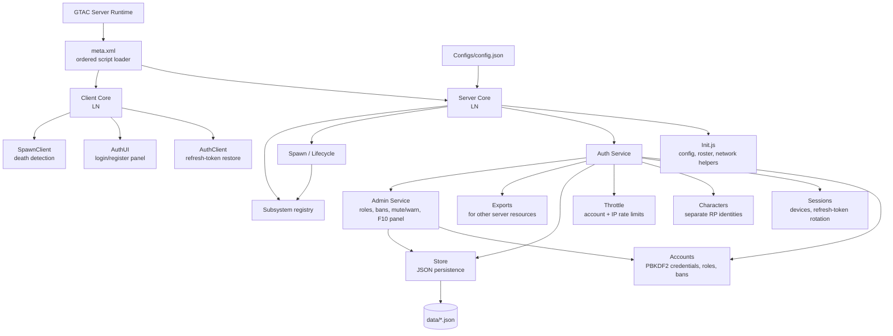

# Liberty Network Architecture Map

This document maps the current `0.4.0` resource. It describes the code as it
exists today, including the known implementation gaps at the end.

## Runtime map



## Startup and player lifecycle

```mermaid
sequenceDiagram
    participant R as GTAC Runtime
    participant S as Server Init
    participant A as Auth Service
    participant C as Client Init
    participant U as Auth UI
    participant P as Spawn

    R->>S: OnResourceStart
    S->>S: Load and merge config
    S->>P: Initialise spawn + network hooks
    S->>A: Initialise stores, auth handlers, API
    R->>S: OnPlayerJoined
    S->>C: ln:greet
    S->>S: Fade camera; do not spawn
    C->>C: Initialise AuthClient and AuthUI
    C->>A: ln:refresh(stored refresh token), if present
    U->>A: ln:login or ln:register
    A->>S: onAuthenticated(client)
    S->>P: spawnPlayer(client)
    P->>C: ln:spawnState
```

## Authentication flow

1. The UI sends `ln:register(username, password, email)` or
   `ln:login(username, password)` as positional network arguments.
2. `Auth.Network` passes the request to `Auth.Service`.
3. The service validates throttle state, then `Accounts` creates or verifies
   a PBKDF2-HMAC-SHA256 password record.
4. `Sessions` creates a device record and issues access/refresh tokens. Only
   token hashes are persisted in `sessions.json`; refresh tokens rotate.
5. The service binds the account and session to the in-memory GTAC client,
   records a non-secret security-log entry, then calls `onAuthenticated`.
6. Server `Init` spawns the player and pushes `ln:authState`; the network
   layer sends `ln:authResult`, which lets `AuthClient` save the refresh token.

## Spawn and death flow


`LN.Subsystems` is the intended extension seam: registered resources may
resolve a spawn point, veto a spawn, and observe spawn/death events.

## Persistent data ownership

| File | Owned by | Contents |
| --- | --- | --- |
| `accounts.json` | `Auth.Accounts` | Accounts, password-hash specification, roles, permissions, ban state, character IDs |
| `characters.json` | `LN.Characters` | Character identity and future RP state |
| `sessions.json` | `Auth.Sessions` | Hashed access/refresh tokens, expiry, revocation state |
| `devices.json` | `Auth.Sessions` | Account-to-device records |
| `security_log.json` | `Auth.Service` | Bounded (2,000 entry) security audit events |

## Public contracts

**Client → server:** `ln:register`, `ln:login`, `ln:refresh`, `ln:logout`,
`ln:listSessions`, `ln:revokeSession`, `ln:requestRespawn`.

**Server → client:** `ln:greet`, `ln:authState`, `ln:authResult`,
`ln:authError`, `ln:sessionList`, `ln:spawnState`.

**Exports for other resources:** `ln_auth_isAuthenticated`,
`ln_auth_identity`, `ln_auth_issueTicket`, `ln_auth_redeemTicket`,
`ln_auth_characters`, `ln_spawn_player`, `ln_spawn_respawn`,
`ln_spawn_onDeath`, `ln_spawn_state`.

## Admin module (new in 0.4.0)

`Core/Server/Admin/` (`Roles.js`, `Bans.js`, `Service.js`+`Service2.js`+
`Service3.js`, `Network.js`+`Network2.js`+`Network3.js`) depends on Auth and
refuses to boot without it. No parallel identity store: staff = LN account
roles (`moderator`/`admin`), permission-checked server-side per action.

* **Roles:** numeric levels for v-admin parity (0/1/2, console 999) +
  `config.admin.commandLevels` map (fail-closed default 2). Only console can
  demote an admin.
* **Bans:** account (perm/temp with `banUntil`), IP, and best-effort HWID
  (`serial/guid/ip/name` SHA-256 — spoofable repeat-offender signal, never
  sole proof). Tempbans escalate (`escalationMultiplier^banCount`, capped);
  expiry auto-lifts via the 60s maintenance prune + join/auth gates.
  Ban = immediate `logout(all)` + kick. Join gate (`Init.onPlayerJoined`)
  rejects banned IP/HWID; auth gate (`onPlayerAuthenticated`) rejects banned
  accounts; audit entries `admin:*` go to the bounded `security_log`.
* **Moderation:** `akick/atempban/aban/aunban`, `abanip/aunbanip`,
  `ahwidban/ahwidunban`, `amakeadmin/amakemod/ademote`, `amute/aunmute`
  (`OnPlayerChat` swallow), `awarn` (capped 50), `alistplayers` (mod Name+ID,
  admin +IP), `abanlist`, `aannounce`, `aadminhelp/aadminstatus`, `/admin`.
* **F10 panel** (`Core/Client/Admin/Panel*.js`): staff-only overlay, same
  draw/cursor technique as `Auth/UI`. F10 toggles; Up/Down select, Left/Right
  tabs, Enter confirm, Backspace delete/back, Esc close/back; mouse click
  hit-tests rows; reason typed via `OnCharacter`. All actions emit
  `ln:adminAction` (positional primitives) and the server re-checks.

## Code review and implementation status

### Rating: 7.5 / 10 (strong foundation, needs in-game and automated testing)

The design, namespace discipline, loading order, comments, JSON data
separation, and intended integration seams are very good. The previously
identified auth/spawn correctness issues are fixed. The score is now held back
mostly by missing automated and in-game integration testing.

1. **Resolved — server-side spawn gate.** All spawn, respawn, and death entry
   points now enforce the configured authentication requirement.
2. **Resolved — time-unit mismatch.** Spawn timestamps and `cooldownMs` now
   use milliseconds consistently.
3. **Resolved — client respawn startup.** `SpawnClient.init()` now runs from
   the client bootstrap.
4. **Resolved — session retention.** Expired refresh-token sessions are pruned
   at startup and during periodic maintenance; refresh expiry also revokes the
   stale record immediately.
5. **Resolved — revocation and ticket state.** Revoking the active session
   clears its in-memory authentication state, and any later authentication
   check observes revoked/expired persistent sessions. Ticket issue/redemption
   now refuses unavailable or banned accounts.
6. **Resolved — client refresh token is memory-only (no secure store exists).**
   The GTAC wiki documents only ordinary unsandboxed file I/O
   (`saveTextFile`/`loadTextFile`/`openFile`) with no per-user sandbox, ACL,
   encryption, or credential-store API, so a client-side token file would be
   a portable plaintext bearer secret. `Core/Client/Auth/Init.js` therefore
   keeps the token in a closure (`memToken`), never calls file I/O, wipes it
   on logout / `invalid_refresh_token` / `refresh_expired` / `device_mismatch`,
   and requires re-login after restart. Server-side mitigations (hash-only
   storage, rotation, expiry revocation + pruning, device-mismatch revocation)
   remain in place, and `tests/t2.js [7]` asserts the no-file-I/O property.
7. **Resolved — deterministic test harness added.**
   `tests/` (`harness.js`, `t1.js`, `t2.js`, `t3.js`, `t4.js`, `tiny.js`; run `node tests/t4.js`)
   covers SHA-256/PBKDF2 vectors (checked against Node crypto), account
   validation, token rotation/replay/expiry/device-mismatch/revocation/logout,
   login throttling, auth-gated spawning, and ms-vs-seconds time-unit behavior,
   plus admin roles/punishments/escalation/IP+HWID bans/mute/warn/F10 keys
   (currently 80/80 passing).

## Suggested next implementation order

1. Verify login-gated spawning and death/respawn in a live GTAC session.
2. Add a minimal repeatable test harness for auth and lifecycle code.
3. Confirm the GTAC client token-file privacy model before production use.
4. Begin character selection and persistence.
